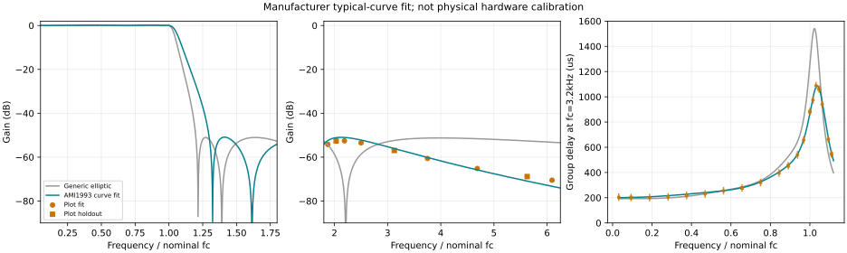

# AMI typical-curve reconstruction profile — checkpoint0.21

The default nominal reconstruction now follows the manufacturer's amplitude
AND group-delay curves more closely. This is a fit to published typical data,
not physical calibration, recovered silicon coefficients, or proof that every
original EII chip matches a later B revision. The generic profile remains
available explicitly for comparison.



## Evidence and provenance

Source: user-supplied63928.pdf, AMI S3528B Programmable Low Pass Filter,
February1993, printed44..53 (PDF1..10). SHA256:
`6f6deb600c1547e1b5be41b9a35b81eb68db51ac3c38e694f4653003e7e47c9e`.
The ten manufacturer pages were rendered and visually checked; the extra
Findchips page is not a technical reference. Original PDF stays outside main.

PDF6/printed49 Figure5 provides the nominal3.2kHz loss curve; PDF7/printed50
Figure9 provides group delay. PDF8/printed51 names rejection notches near
1.325fc and1.62fc. The1984 AMI catalog already used by this project contains
corresponding family curves and notch descriptions. This consistency does not
establish identical silicon revisions or individual-component behavior.

The1999 Chinese application article confirms the40N frequency relation and
external amplifier connections but supplies no internal coefficients or new
physical capture. The two Google AI coefficient lists are unverified and
numerically inconsistent with their stated claims; neither is used here.

Timing correction: in the1993 PDF3/printed46 table, tAS300ns and tAH20ns sit
in the **Typ.** column. tCE200ns is Min.,300ns Typ. The earlier conversational
claim that300ns setup was a manufacturer minimum was too strong. No CPU timing
or digital CE requirements are changed on that basis. Typical6ms settling at
nominal3.2kHz is a measurement target, not an invented mute/delay timer.

## Digitization

`data/s3528b_1993_reference.json` contains20 delay and9 stopband readings,
source hash, PDF crop rectangles, pixel axes, threshold, pixel locations and
fit/holdout assignment. `tools/extract_s3528_reference.py` reproduces them with
PyMuPDF/Pillow/NumPy and refuses a different source hash. It uses rendered
pixels, not OCR numeric guesses. Axes/crops and extracted curve alignment were
checked visually. Scan-reading allowances are30us delay and1.5dB loss;
these are conservative project allowances, not statistical confidence limits
or manufacturer tolerances. Rendering/library changes can shift a pixel.

Every third reading with index%3==1 is reserved:7 delay and3 stopband points.
Only the remaining19 plot readings enter the fit objective. The holdout checks
are independently excluded from optimization, but they still share the same
manufacturer scan and are NOT an independent hardware dataset.

## Fitted mathematical model

A stable seven-pole rational core with two finite conjugate notch pairs is a
compact approximation chosen to follow the observed curves. It is not an
assertion about the chip's capacitor matrix or exact elliptic ladder network.
The normalized analog core has one real pole and three damped quadratic
sections; zeros are placed at +/-j1.325 and +/-j1.62. DC gain is normalized to1.
Three missing analog zeros map to z=-1 under the bilinear transform. This
chosen numerator order is a fitting assumption, not recovered AMI topology.

The core is bilinear-transformed at40 samples per nominal cutoff cycle with
scale80*tan(pi/40). Consequently the digital notches are near1.323fc and1.615fc,
not asserted exact chip frequencies. The existing pair-average input stage at
80fc is retained. Comparison with continuous-output plots also includes the
sample/hold sinc magnitude and its delay. Total prefilter/hold delay used in
the curve comparison is3/(160fc); this is a stated observation model.

Seven positive pole parameters are bounded during least squares. The objective
combines fit-split delay/loss readings, typical edge values and penalties for
passband departures beyond about0.1dB relative to0.6fc and inadequate stopband
rejection. It does not consume held-out points. No random noise, feedthrough
sine or saturation is added to disguise response error.

Reproduce with SciPy1.17.0/NumPy2.3.5:

```
python tools/extract_s3528_reference.py ../upload/63928.pdf
OPENBLAS_NUM_THREADS=1 python tools/fit_s3528.py --write --plot
```

`--write` updates src/s3528_curve_coefficients.h and
validation/s3528-curve-fit.json. `--plot` writes the source SVG comparison.
Three deterministic initial seeds and fixed bounds/objective are retained in
the script. Numerical library/platform variation can slightly change optimized
parameters; compare transfer/error budgets rather than assuming bit-identical
optimizer output everywhere. No SciPy/NumPy runtime dependency is added to C++.

## Executing-kernel validation

The native test drives the actual C++ kernel with sinusoids and fits complex
output at the actual update timestamps. It then includes the continuous hold
factor. Group delay is measured from neighboring-frequency phase differences.
It does not merely evaluate the embedded coefficients against themselves.

| Check | Result |
| --- | --- |
|7 held-out group-delay points, maximum error|12.28us; old generic375.45us|
|7 held-out delay points, RMS error|7.48us|
|3 held-out stopband points, maximum error|2.06dB|
|3 held-out stopband points, RMS error|1.56dB|
|All20 plotted delay points, maximum error|20.02us|
|All9 plotted stopband points, maximum error|2.79dB|
|Relative passband maximum, dense offline grid|0.0951dB|
|Gain at1.06fc relative to0.6fc|about-3.94dB; typical target-3, listed envelope-5.5..-0.5dB|

The3dB stopband test budget is model approximation error; it must not be
confused with the1.5dB scan-reading allowance. Residuals are larger than the
reading allowance at some frequencies, especially the high end. Near-notch
depths and the full high-frequency/clock-image response remain approximate.
The1.32fc table typical value is about-65dB while the fit is about-71.7dB before
reference normalization; the idealized notch model does not reproduce finite
chip rejection/noise depth. Individual plotted checks do not establish
performance outside the sampled domain.

## Runtime integration

`S3528NominalResponse` defaults to `S3528Profile::Ami1993TypicalFit`.
`S3528Profile::GenericElliptic` retains the old SciPy7/.1/51 profile.
ClockedPlaybackOptions carries the selected profile; audio_probe records its
name in capture metadata. `--legacy-generic-reconstruction` selects the old
profile. Unknown initial states, code-change phase invalidation, explicit
experiment controls, channel0 MODE guard and digital clock ordering remain.

No FC/Q/VCA laws, nonlinear clipping/noise/feedthrough, true divider restart
phase, S3528 input amplifier/loading or production host resampler are inferred
from these curves. The normalized3.2kHz prototype is scaled across codes as a nominal assumption.
The manufacturer also shows high-cutoff curve families with departures from
ideal scaling; this single fit does not certify every clock/code, particularly
at the high end.

The B-derived nominal fit is useful evidence-based progress,
but physical EII calibration and complete audible OS playback remain pending.
